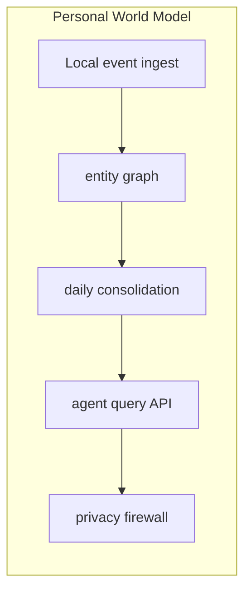

# Personal World Model

  

> A continuously updated private simulation of a person's work, home, and commitments.

**Repository:** [https://github.com/AIFrontiersLab/PersonalWorld](https://github.com/AIFrontiersLab/PersonalWorld)

---

## Why this exists

Software still stores files and messages, not a living model of a person's world.

**Why now:** Long-context models and local SLMs make a private continuously updated model feasible.

**What recently changed:** Local 9B-class models and cheaper multimodal understanding.

**Why it was hard before:** Memory was session-based; on-device models were too weak; sensors were siloed.

---

## Product thesis

| | |
|---|---|
| **Future thesis** | By 2035 millions use a private world model the way they used a smartphone home screen in 2015. |
| **First customer** | Power users already running local models |
| **Market** | Personal infrastructure |
| **Convergence** | Persistent Memory, World Models, Small Models |
| **Moat** | Years of private state that cannot be re-scraped. |

---

## MVP

A local daemon that maintains a structured model of projects, people, and open loops, queryable by agents.

### Core loop

1. Accept an agent (or human-on-behalf-of-agent) intent
2. Enforce scope / policy / evidence
3. Execute the smallest useful autonomous step
4. Leave an audit trail a human can kill-switch

---

## Architecture

```text
Local event ingest, entity graph, daily consolidation, agent query API, privacy firewall.
```



---

## Start

```bash
python3 -m http.server 4173 --directory .
```

---

## Why it may win

Every agent is more useful with a persistent world than with chat history.

## Why it may fail

OS vendors ship a weaker version for free.

### Risks

- Feels like surveillance to the owner

### Unknowns

- Whether users will tolerate the setup cost

### Current alternatives

- Note apps
- personal CRMs
- chat memory

### Assumptions

- Agent workflows will keep expanding into real systems

---

## Scope

This project is intentionally scoped to **AI and Agentic AI** only.

---

## Tags

`ai` `agentic-ai` `autonomous-agents` `nocta` `prototype` `persistent-memory` `world-models` `small-models`
